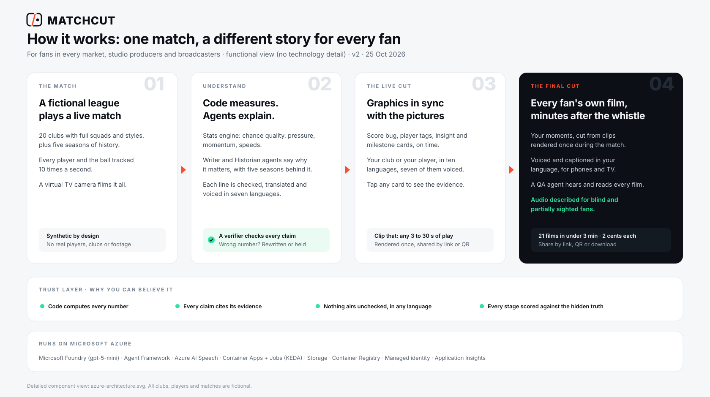
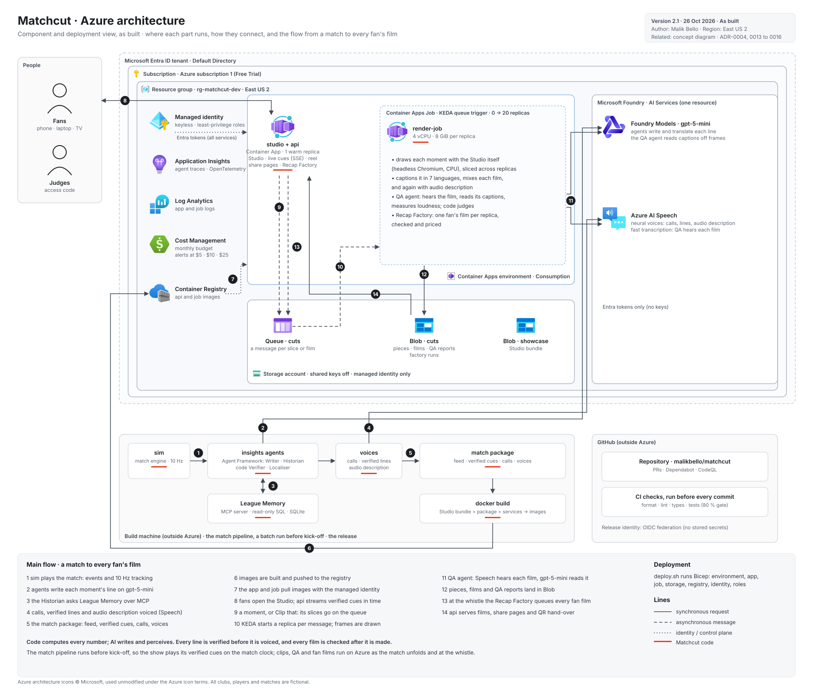

# Matchcut

**Every fan's cut.** Matchcut turns a live stream of synthetic football events into verified, explainable on-screen insight. Minutes after the final whistle, it gives every fan their own voiced, captioned highlights film: their club, their player, their language.



> All clubs, players, grounds and matches are fictional and generated by Matchcut's own simulator. No real match data or footage is used.

## Architecture



Details, the numbered flow and design decisions: [docs/architecture](docs/architecture/README.md).

## Run it yourself

Requires [uv](https://docs.astral.sh/uv/). Python 3.12 is installed automatically.

```bash
uv sync                                   # install the locked workspace
uv run matchcut-sim league                # 26 clubs, five seasons of history -> data/league
uv run matchcut-memory-build              # League Memory database -> data/league/memory.sqlite
uv run matchcut-sim match --home kes --away irv --seed 7   # one full match: events, 10 Hz tracking, truth
uv run matchcut-sim realism --matches 12  # compare simulated matches with top-flight norms
uv run matchcut-sim cdf --home kes --away irv  # export a match in the Common Data Format (CDF v0.3.2)
uv run matchcut-sim feed --home kes --away wcr  # 5 Hz positions feed for the Studio's data pitch
uv run matchcut-insights redteam            # plant false claims; measure what the Verifier catches (offline)
uv run pytest                             # tests (no cloud access needed)
```

### Live insights agents (Azure AI Foundry)

Sign in with an Entra ID account that has *Cognitive Services OpenAI User* on the Foundry resource (no keys are used), then:

```bash
export AZURE_OPENAI_ENDPOINT=https://<your-foundry-resource>.cognitiveservices.azure.com/
export AZURE_OPENAI_MODEL=gpt-5-mini
uv run matchcut-insights run --home kes --away wcr --seed 7     # verified cues -> out/insights/kes-wcr-7.jsonl
uv sync --extra evals                                           # Azure AI Evaluation (eval runs only)
uv run matchcut-insights eval --matches 2 --judges             # scorecard + Azure AI Evaluation -> reports/insights-eval.md
```

### Studio

```bash
export MATCHCUT_ACCESS_CODE_SHA256=$(printf '%s' 'choose-a-code' | sha256sum | cut -d' ' -f1)
export MATCHCUT_INSECURE_COOKIE=1   # local http only
uv run matchcut-api                 # http://127.0.0.1:8080
```

The same seed always produces the same match. Reports: [realism](reports/realism.md) · [tactical detection](reports/tactical-detection.md) · [insights agents](reports/insights-eval.md) · [Verifier red team](reports/verifier-redteam.md).

## Brand

[Brand system](docs/brand/brand-system.md) · [brand board](docs/brand/brand-board.png)

## Status

Build in progress: see [status.md](status.md) and [build_plan.md](build_plan.md).

## Credits

Azure architecture icons © Microsoft, used unmodified under the [Azure icon terms](https://learn.microsoft.com/azure/architecture/icons/). Fonts: Big Shoulders Display, Inter and JetBrains Mono (SIL Open Font License).
