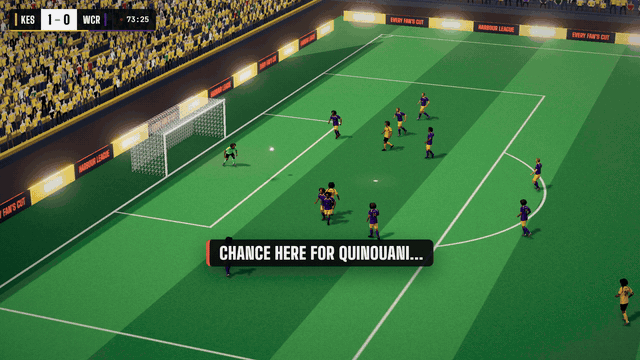
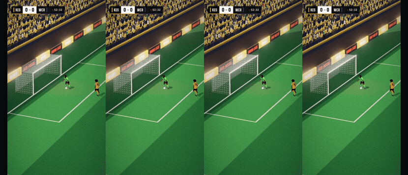
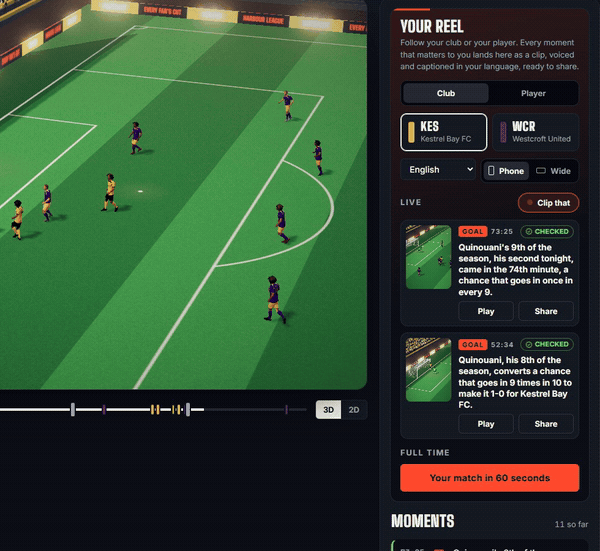
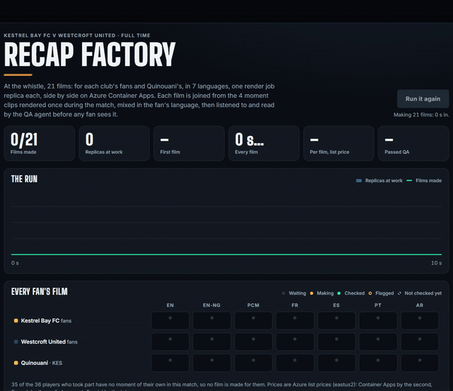

# Matchcut

**Every fan's cut.** Matchcut turns a live stream of synthetic football events into verified, explainable insight on a broadcast-style 3D show. Minutes after the final whistle, it gives every fan their own voiced, captioned highlights film: their club, their player, their language, and an audio-described version for blind and partially sighted fans. Every film is watched and heard by a QA agent before any fan sees it.

**Live on Azure Container Apps:** https://ca-matchcut-studio.livelygrass-1374f622.eastus2.azurecontainerapps.io (the access code is in the submission's testing instructions). The Recap Factory is at `/factory.html`.

## See it

[](https://youtu.be/7ei7k6i2XI0)

**[Watch the demo film (1:53)](https://youtu.be/7ei7k6i2XI0)**: the goal as Matchcut renders it, then a fan's path through the live product step by step, the Recap Factory at full time, and how it is built.

| The goal, as Matchcut renders and verifies it | One goal, four fans, four languages |
|---|---|
|  |  |
| **A fan's reel: follow a player, switch to Pidgin, press Play** | **The Recap Factory: 42 films on Azure Container Apps** |
|  |  |

All four are recorded from the live deployment. The films have sound (calls, analysts, the describer); these loops are silent.

## Try it (about 3 minutes, the same steps as the demo video)

1. Open the live link and enter the access code from the submission's testing instructions.
2. **Watch it live.** The Studio plays a synthetic match in 3D; verified lines appear as moments happen. Press **Evidence** on a line to see the facts it cites.
3. **Your reel → Player → Quinouani.**
4. **Language → Naijá (Pidgin)**, or any of the seven voiced languages. Each moment's line switches language.
5. **Play** on a moment: a voiced, captioned film in that language.
6. **Share**: a link and a QR code for the film.
7. **Top bar → Audio description**: every film moves to its described version, for blind and partially sighted fans.
8. **Top bar → Factory → Run it again**: 20 replicas make 42 films (each fan's film and its described twin) in about three minutes. Click any film to play it, with or without audio description, and read the QA agent's verdict. Runs are rationed to one every 30 minutes and six a day; the last run's films always stay on the page.


> All clubs, players, grounds and matches are fictional and generated by Matchcut's own simulator. No real match data or footage is used.

## What it does

| | |
|---|---|
| **Explained as it happens** | Agents on Microsoft Foundry (gpt-5-mini) run as a Microsoft Agent Framework workflow: an Analyst and a Historian work in parallel, a Writer drafts the line, and a deterministic Verifier checks every number against the fact it cites, with one revision. Nothing unverified airs. |
| **League Memory** | Five seasons of the league's history, served to the agents as tools over MCP, so a goal arrives with its story: "Quinouani's 9th of the season, his second tonight". |
| **Every fan's cut** | Follow a club or a player; every moment becomes a film, voiced and captioned in seven languages (English, Nigerian English, Naijá, French, Spanish, Portuguese, Arabic), for phones (9:16) and TV (16:9), shared by link or QR. |
| **Audio description** | Every film is made twice: the second has a describer, in the same seven languages, who says what is on screen in the gaps the commentary leaves (who has the ball and where, the build-up, the goal, the celebration, each replay). |
| **The Recap Factory** | At full time, one queue message per fan fans out across Azure Container Apps Jobs; each replica joins its fan's film from clips rendered once during the match, mixes it, has it checked and prices it. |
| **The QA agent** | After a film is made, Azure AI Speech hears it, gpt-5-mini reads its captions off the frames and an EBU R128 meter measures its loudness; code judges the result against the film's plan. A line the whole-film transcript misses gets a second listen on its own. |

## Measured on Azure

| | |
|---|---|
| Recap Factory, run f-090104fcae1d | 21 fans, 42 films (each fan's film and its described twin), first film 74 s after Start, all 42 in 3 min 10 s, 20 replicas at peak, US$0.022 a film at list price; the QA agent passed 41 and flagged 1 |
| Recap Factory, run f-54036148a78b | 42 films in 3 min 22 s, 42 of 42 passed QA |
| Moment films | 28 of 28 pass QA, and 28 of 28 described |
| Verifier red team | 709 of 709 planted false lines caught, 0 of 128 true lines rejected ([report](reports/verifier-redteam.md)) |

## Microsoft technologies

| Technology | Where |
|---|---|
| Microsoft Foundry (gpt-5-mini), keyless with Entra ID | the insight agents and the QA agent's reader ([brain.py](services/insights/src/matchcut_insights/brain.py), [qa_agent.py](services/recap/src/matchcut_recap/qa_agent.py)) |
| Microsoft Agent Framework | the Analyst, Historian, Writer and Verifier workflow graph ([workflow.py](services/insights/src/matchcut_insights/workflow.py)) |
| MCP | League Memory server ([server.py](services/league-memory/src/matchcut_memory/server.py)) |
| Azure AI Speech | the callers, analysts and describers in seven languages; fast transcription for the QA agent ([voice.py](services/insights/src/matchcut_insights/voice.py)) |
| Azure Container Apps and Container Apps Jobs (KEDA queue scaler) | the Studio and API; the render job that makes clips during the match and every fan's film at full time ([main.bicep](infra/main.bicep), [job.py](services/recap/src/matchcut_recap/job.py)) |
| Azure Storage (Blob, Queue), Container Registry, Application Insights, managed identity | films, the job queue, images, OpenTelemetry traces; no keys anywhere, least-privilege roles ([main.bicep](infra/main.bicep)) |

**Cloud native by design:** event-driven (a queue message per moment and per fan, KEDA scales the job from zero to 20 replicas), keyless (managed identity and Entra ID for every service call), defined in Bicep and deployed by one script, and priced per film: every Factory run records each film's compute and QA cost at Azure list prices, under a budget alert.

## Architecture


Details, the numbered flow and design decisions: [docs/architecture](docs/architecture/README.md).

## Run it yourself

Requires [uv](https://docs.astral.sh/uv/). Python 3.12 is installed automatically.

```bash
uv sync                                   # install the locked workspace
uv run matchcut-sim league                # 20 clubs, five seasons of history -> data/league
uv run matchcut-memory-build              # League Memory database -> data/league/memory.sqlite
uv run matchcut-sim match --home kes --away irv --seed 7   # one full match: events, 10 Hz tracking, truth
uv run matchcut-sim realism --matches 12  # compare simulated matches with top-flight norms
uv run matchcut-sim cdf --home kes --away irv  # export a match in the Common Data Format (CDF v0.3.2)
uv run matchcut-sim feed --home kes --away wcr  # 5 Hz positions feed for the Studio's data pitch
uv run matchcut-insights redteam            # plant false claims; measure what the Verifier catches (offline)
uv run pytest                             # tests (no cloud access needed)
```

### Live insights agents (Azure AI Foundry)

Sign in with an Entra ID account that has *Cognitive Services OpenAI User* on the Foundry resource (no keys are used), then:

```bash
export AZURE_OPENAI_ENDPOINT=https://<your-foundry-resource>.cognitiveservices.azure.com/
export AZURE_OPENAI_MODEL=gpt-5-mini
uv run matchcut-insights run --home kes --away wcr --seed 7     # verified cues -> out/insights/kes-wcr-7.jsonl
uv sync --all-packages --extra evals                            # Azure AI Evaluation (eval runs only)
uv run matchcut-insights eval --matches 2 --judges             # scorecard + Azure AI Evaluation -> reports/insights-eval.md
```

### Studio

```bash
export MATCHCUT_ACCESS_CODE_SHA256=$(printf '%s' 'choose-a-code' | sha256sum | cut -d' ' -f1)
export MATCHCUT_INSECURE_COOKIE=1   # local http only
uv run matchcut-api                 # http://127.0.0.1:8080 (the Recap Factory: /factory.html)
uv run matchcut-recap qa --match kes-wcr-7 --langs en,ar   # the QA agent: listen to and read each clip's film
```

The same seed always produces the same match. Reports: [realism](reports/realism.md) · [tactical detection](reports/tactical-detection.md) · [insights agents](reports/insights-eval.md) · [Verifier red team](reports/verifier-redteam.md).

## Brand

[Brand system](docs/brand/brand-system.md) · [brand board](docs/brand/brand-board.png)

## Engineering

A uv workspace (Python 3.12) with locked dependencies; ruff, pyright and pytest with an 80% coverage gate (85% today); every design decision recorded in [docs/adr](docs/adr) (ADR-0001 to ADR-0016); progress and measurements in [status.md](status.md).

## Credits

Azure architecture icons © Microsoft, used unmodified under the [Azure icon terms](https://learn.microsoft.com/azure/architecture/icons/). Fonts: Big Shoulders Display, Inter and JetBrains Mono (SIL Open Font License).
